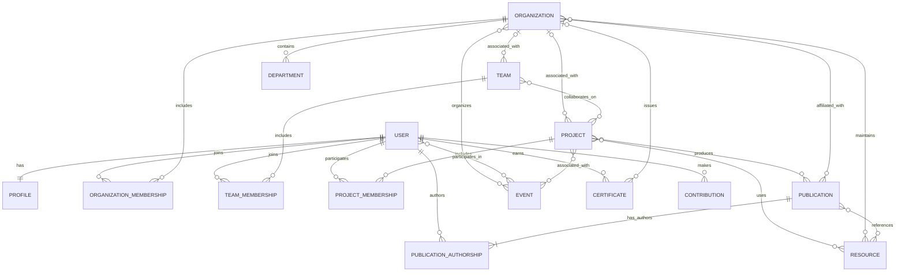

# DPRC Platform — Conceptual Data Model

> **Document Version:** 2.0  
> **Status:** Living Document  
> **Document Type:** Conceptual Data Model  
> **Project:** DPRC Platform

---

# 1. Purpose

This document defines the conceptual data model of the DPRC Platform, including its core entities, their responsibilities and the relationships between them.

The objective is to establish a connected engineering and research information environment in which people, organizations, projects, publications, events and technical resources can reference one another through meaningful relationships.

This document describes the conceptual model rather than a finalized database schema.

Implementation details such as table structures, column definitions, data types, primary keys, foreign keys, indexes, constraints and migration strategies will be established separately during backend and database development.

---

# 2. Data Modeling Philosophy

The DPRC Platform should organize information around identifiable entities and their relationships.

Rather than storing related information as isolated records, the model should make it possible to understand how different entities are connected.

For example:

- A user may participate in multiple projects.
- A project may involve multiple users and teams.
- A publication may document the results of a project.
- An organization may be associated with projects and publications.
- An event may involve participants, organizations and projects.
- A resource may support research or engineering activities.

The model should support these relationships without introducing unnecessary complexity.

---

# 3. Core Entities

## 3.1 User

Represents an individual registered on the platform.

Potential user categories include:

- Student
- Researcher
- Faculty member
- Professional
- Alumni
- Industry representative
- Administrator

A user may be associated with:

- One profile
- Multiple organizations
- Multiple teams
- Multiple projects
- Multiple publications
- Multiple events
- Multiple certificates
- Multiple contributions

A user's access and available functionality depend on the platform's authentication and authorization model.

## 3.2 Profile

Represents the professional and personal information associated with a user.

Each profile belongs to exactly one user.

Potential profile information includes:

- Profile identifier
- Name
- Biography
- Profile photo
- Skills
- Education
- Experience
- Portfolio information
- Social links
- Research interests

A profile is conceptually associated with its user rather than functioning as an independent platform identity.

## 3.3 Organization

Represents an organization participating in engineering, research, education or collaboration.

Examples include:

- Dhaka Polytechnic Research Club (DPRC)
- Universities
- Academic institutions
- Companies
- Research laboratories
- Industry partners

An organization may be associated with:

- Members
- Departments
- Teams
- Projects
- Publications
- Events
- Resources

Organizational membership and other relationships should be represented separately where they require additional information such as roles, membership status or dates.

## 3.4 Department

Represents a functional or academic division within an organization, where applicable.

A department may be associated with:

- An organization
- Members
- Teams
- Projects
- Events
- Resources

The exact structure and applicability of departments will depend on organizational requirements.

## 3.5 Team

Represents a collaborative group working toward a shared objective.

A team may:

- Be associated with an organization.
- Contain multiple users.
- Participate in multiple projects.
- Have designated roles or responsibilities.
- Maintain team-related resources and activities.

Team membership should be represented through a separate association so that membership roles, status and dates can be maintained.

## 3.6 Project

Represents an engineering, research or development activity.

Projects are a central collaboration entity within the platform.

A project may contain or reference:

- Project lead
- Project members
- Associated teams
- Associated organization
- Timeline
- Status
- Documentation
- Files
- Discussions
- Publications
- Resources
- Progress records
- Activity history

Projects may also have version history and relationships with related projects.

Project branching, merging and archival should be introduced only when the relevant workflows and data requirements are defined.

## 3.7 Publication

Represents a documented research or technical output.

Examples include:

- Journal papers
- Conference papers
- Technical reports
- White papers
- Research articles
- Engineering documentation

A publication may be associated with:

- One or more authors
- Related projects
- Organizations
- References
- Supporting files
- Datasets
- Publication metadata

Author relationships should support multiple contributors and appropriate authorship information.

## 3.8 Event

Represents a scheduled or organized activity.

Examples include:

- Workshops
- Competitions
- Conferences
- Seminars
- Exhibitions
- Training programs
- Research presentations

An event may involve:

- Organizing organizations
- Teams
- Projects
- Participants
- Supporting resources
- Related publications

Participation and organization relationships should be represented separately when additional information is required.

## 3.9 Resource

Represents reusable educational, technical or research material.

Examples include:

- Documents
- Books
- Tutorials
- Templates
- Datasets
- Software references
- Engineering standards
- Technical materials

A resource may be associated with:

- Projects
- Organizations
- Publications
- Events
- Users

Resource ownership, access permissions and storage references should be handled according to the relevant platform requirements.

## 3.10 Certificate

Represents an achievement, qualification or recognition associated with a user.

Examples include:

- Competition awards
- Training completion certificates
- Professional certifications
- Academic achievements
- Recognition for contributions

A certificate may reference:

- The recipient user
- Issuing organization
- Related event or program
- Issue date
- Supporting document

Certificate authenticity and verification requirements may be introduced as the feature develops.

## 3.11 Contribution

Represents a recorded contribution made by a user to a platform activity or engineering output.

Potential examples include:

- Project contributions
- Research contributions
- Technical documentation
- Publication contributions
- Event organization
- Knowledge sharing

A contribution may be associated with a user and one or more relevant projects, publications, events or resources.

Contribution records should preserve appropriate attribution and timestamps.

---

# 4. Relationship Model

Relationships should be represented according to their actual business meaning and cardinality.

Some relationships may require dedicated association entities rather than direct references.

## 4.1 User Relationships

A user may:

- Have exactly one profile.
- Join multiple organizations.
- Belong to multiple teams.
- Participate in multiple projects.
- Author multiple publications.
- Participate in multiple events.
- Earn multiple certificates.
- Record multiple contributions.

The relationship between a user and an organization may include:

- Membership role
- Membership status
- Joining date
- Leaving date, where applicable

## 4.2 Organization Relationships

An organization may:

- Have multiple members.
- Contain multiple departments.
- Have multiple associated teams.
- Be associated with multiple projects.
- Organize multiple events.
- Be associated with multiple publications.
- Maintain resources.

The model should distinguish between organizational ownership, affiliation, participation and authorship.

These relationships do not necessarily have identical meanings.

## 4.3 Team Relationships

A team may:

- Contain multiple users.
- Be associated with an organization.
- Participate in multiple projects.
- Maintain team-related resources.
- Have designated responsibilities.

Team membership should be maintained independently from project membership.

## 4.4 Project Relationships

A project may:

- Have one or more participants.
- Have a designated project lead.
- Be associated with an organization.
- Involve multiple teams.
- Produce multiple publications.
- Reference multiple resources.
- Maintain discussions and activity records.
- Have related project versions or predecessor projects.

A project may have no associated organization where the applicable workflow permits independent projects.

## 4.5 Publication Relationships

A publication may:

- Have one or more authors.
- Be associated with multiple projects.
- Be affiliated with one or more organizations.
- Reference other publications.
- Include supporting files or datasets.

Authorship, organizational affiliation and project association should be treated as distinct relationships.

## 4.6 Event Relationships

An event may:

- Be organized by one or more organizations.
- Have multiple participants.
- Involve teams.
- Be associated with projects.
- Use supporting resources.
- Produce related publications or documented outcomes.

## 4.7 Resource Relationships

A resource may:

- Support multiple projects.
- Be associated with organizations.
- Support publications.
- Be used in events.
- Be contributed by users.

---

# 5. Conceptual Entity Relationship Overview

The following diagram illustrates the major relationships. It is conceptual and does not define the final database schema.

The association entities shown above are conceptual. Their exact attributes and implementation will be defined during database design.

---

# 6. Global Identifiers

Each major entity should have a stable unique identifier.

Suggested human-readable identifier formats include:

| Entity | Identifier Prefix | Example |
|---|---|---|
| User | USR | USR-000001 |
| Profile | PRF | PRF-000001 |
| Organization | ORG | ORG-000001 |
| Department | DEP | DEP-000001 |
| Team | TEM | TEM-000001 |
| Project | PRJ | PRJ-000001 |
| Publication | PUB | PUB-000001 |
| Event | EVT | EVT-000001 |
| Resource | RES | RES-000001 |
| Certificate | CER | CER-000001 |
| Contribution | CON | CON-000001 |

These formats are proposed display identifiers, not finalized database primary-key definitions.

## 6.1 Identifier Principles

Identifiers should:

- Be unique within their defined entity namespace.
- Remain stable when names or titles change.
- Avoid encoding sensitive personal information.
- Be suitable for referencing records across application modules.
- Be generated and validated consistently.

The database may use internal primary keys independently of human-readable identifiers.

---

# 7. Future Expansion

The conceptual model may expand to support additional entities as platform requirements evolve.

Potential future entities include:

- Research Laboratories
- Patents and Intellectual Property Records
- Funding Opportunities
- Grants
- Mentorship Relationships
- AI Model Records
- IoT Devices
- Simulations
- VR Workspaces
- Plugins
- External API Integrations

These are potential future data domains rather than requirements for the initial database implementation.

New entities should integrate with existing relationships while preserving data integrity and backward compatibility wherever practical.

---

# 8. Data Modeling Principles

The conceptual data model should remain:

## 8.1 Modular

Entities should represent clearly defined concepts and responsibilities.

## 8.2 Extensible

New entities and relationships should be introduced without unnecessarily disrupting existing data structures.

## 8.3 Relationship-Driven

Related information should be connected through meaningful and well-defined relationships.

## 8.4 Consistent

Identifiers, relationship conventions and data definitions should remain consistent across the platform.

## 8.5 Scalable

The model should accommodate increasing data volumes and more complex relationships.

## 8.6 Technology-Independent

The conceptual model should describe the information and its relationships without depending on a particular database engine or storage technology.

## 8.7 Integrity-Focused

The eventual database implementation should use appropriate constraints, validation and transactional operations to preserve data consistency.

---

# 9. Implementation Boundary

This document defines the conceptual data model only.

The following details will be established separately during implementation:

- Database tables and columns
- Primary and foreign keys
- Data types
- Relationship cardinalities
- Unique constraints
- Indexes
- Referential actions
- Association-table attributes
- Database migrations
- Data validation rules
- Access-control implementation

The final relational schema should be derived from the approved conceptual model and actual application requirements.

---

# 10. Guiding Principle

The DPRC Platform should maintain a connected and consistent information model.

Every entity should have a clear purpose, every relationship should represent a meaningful association, and every new data domain should integrate with the existing model in a controlled manner.

The objective is to establish a reliable foundation for engineering research, project collaboration, organizational information management and long-term knowledge preservation.

