# DPRC Platform — User System Plan

> **Document Version:** 2.0  
> **Status:** Living Document  
> **Module:** User System  
> **Project:** DPRC Platform

---

# 1. Overview

The User System is the identity and account-management foundation of the DPRC Platform.

Every registered person has a unique digital identity that connects their profile, research activities, engineering projects, organizational memberships, publications, achievements and contributions.

The User System is designed to support users throughout their academic, engineering and professional development.

It provides shared identity-related functionality to other platform modules, including:

- Authentication
- User profiles
- Account management
- Academic information
- Professional experience
- Skills and research interests
- Membership relationships
- Privacy preferences
- User-related activity and notifications

The User System is not limited to login and registration. It provides the identity foundation through which people participate in the wider platform.

---

# 2. Vision

Create a professional engineering and research identity that can grow with an individual throughout their career.

A person should be able to join the platform as a student and continue using the same account and profile as they develop into a researcher, engineer, entrepreneur, educator or industry professional.

Their relevant academic history, professional experience, projects, publications, achievements and contributions should remain connected to their identity.

The objective is to support long-term professional continuity without requiring users to create a new identity as their careers evolve.

---

# 3. Core Objectives

The User System should enable users to:

- Create and maintain a platform account.
- Build a professional profile.
- Manage academic and professional information.
- Record skills and research interests.
- Join organizations and teams.
- Participate in projects.
- Associate publications with their identity.
- Record achievements and contributions.
- Manage privacy and visibility preferences.
- Access permitted platform services.
- Build a professional portfolio over time.

---

# 4. User Identity

Every registered person has one permanent platform account.

The account represents the user's identity within the DPRC Platform.

## 4.1 Account Information

Potential account information includes:

- Internal User ID
- Public User Identifier
- Username
- Full Name
- Email Address
- Password Hash
- Account Status
- Account Creation Date
- Last Updated Date
- Last Login Information, where appropriate

The User ID should remain stable throughout the lifetime of the account.

Changes to a user's name, username or email address should not change the underlying identity.

## 4.2 Public User Identifier

A human-readable identifier may be assigned to each user.

Example:

```text
USR-000001
USR-000002
USR-000003
```

The prefix and exact identifier format are proposed conventions.

The public identifier should be distinct from the internal database primary key.

Identifiers should:

- Be unique.
- Remain stable.
- Avoid exposing sensitive personal information.
- Be suitable for referencing users across platform modules.

## 4.3 Account Status

Potential account states include:

- Pending Verification
- Active
- Suspended
- Deactivated

The final account-state model should be defined during authentication and account-management implementation.

Account status and user permissions are separate concerns.

---

# 5. User Profile

Every registered user should have one associated profile.

The profile contains information that the user chooses to provide for professional, academic and research purposes.

## 5.1 Profile Information

Potential profile fields include:

- Profile ID
- Full Name
- Profile Photo
- Cover Image
- Short Biography
- Country
- Location, where provided
- Institution
- Department
- Professional Position
- Skills
- Research Interests
- Social Links
- Portfolio Links
- Contact Preferences

Not every field needs to be mandatory.

## 5.2 Profile Visibility

Users should be able to control the visibility of supported profile information.

Potential visibility options include:

- Public
- Members Only
- Private

Visibility settings may apply to individual information fields or supported profile sections.

The platform must enforce these settings when retrieving profile information.

Profile visibility does not replace authorization. A user's permissions to perform an operation must be checked separately.

## 5.3 Profile Management

Users may be able to:

- View their profile.
- Edit permitted profile information.
- Upload or update profile images.
- Manage social links.
- Update visibility preferences.
- View associated projects and publications.
- Review achievements and contributions.

---

# 6. Academic Information

A user may maintain multiple academic records.

This supports individuals who have studied at different institutions or completed multiple qualifications.

## 6.1 Academic Record Information

Potential fields include:

- Institution
- Institution Type
- Department
- Degree or Qualification
- Field of Study
- Enrollment Date
- Graduation Date
- Current Semester, where applicable
- Academic Status
- Description

## 6.2 Institution Types

Examples include:

- School
- College
- Polytechnic Institute
- University
- Training Institution
- Other Academic Institution

Academic records should be associated with the relevant user.

A user's academic history should not be restricted to a single institution or qualification.

---

# 7. Professional Information

Users may record their professional experience and career history.

Potential professional roles include:

- Student
- Research Assistant
- Lecturer
- Engineer
- Developer
- Designer
- Technical Specialist
- Entrepreneur
- Industry Professional

## 7.1 Experience Information

Potential fields include:

- Organization or Company
- Position
- Employment Type, where applicable
- Start Date
- End Date
- Current Position Status
- Description
- Relevant Skills

Users may maintain multiple professional experience records.

Professional experience should remain separate from platform roles and organizational membership roles.

For example, being an engineer professionally does not automatically grant administrative permissions within the DPRC Platform.

---

# 8. Skills

The User System should allow users to maintain a structured list of technical and professional skills.

Examples include:

- C++
- JavaScript
- React
- PCB Design
- AutoCAD
- SolidWorks
- MATLAB
- Python
- Embedded Systems
- Robotics
- Machine Learning
- Power Systems

## 8.1 Skill Records

A skill may contain:

- Skill ID
- Skill Name
- Description
- Category

Users should associate relevant skills with their profiles.

## 8.2 Skill Proficiency

Potential proficiency levels include:

- Beginner
- Intermediate
- Advanced
- Expert

Proficiency is user-provided information unless a separate assessment or verification mechanism is implemented.

The platform should not automatically treat a self-declared proficiency level as a verified qualification.

## 8.3 Skill Discovery

Structured skills may support:

- Researcher discovery
- Project participant discovery
- Collaboration opportunities
- Skill-based search
- Future recommendations

---

# 9. Research Interests

Users may record their areas of academic and technical interest.

Examples include:

- Artificial Intelligence
- Renewable Energy
- Robotics
- Power Systems
- Internet of Things
- Embedded Systems
- Telecommunications
- Computer Vision
- Automation and Control
- Electronics

Research interests should use structured categories where practical.

They may support:

- Researcher discovery
- Project recommendations
- Related publication discovery
- Collaboration opportunities
- Future AI-assisted recommendations

Research interests should remain distinct from demonstrated skills.

---

# 10. Project Relationships

Users may participate in multiple engineering and research projects.

The User System should reference project membership records maintained through the shared project-management model.

## 10.1 Project Participation

Users may:

- Create projects where authorized.
- Request to join projects.
- Accept project invitations.
- Participate in project activities.
- Leave projects where permitted.
- View their associated project history.

## 10.2 Project Membership Information

Potential membership information includes:

- User ID
- Project ID
- Project Role
- Membership Status
- Join Date
- End Date, where applicable
- Contribution References

Potential project roles include:

- Founder
- Project Lead
- Researcher
- Developer
- Designer
- Reviewer

These are examples of project responsibilities, not universal platform permissions.

A project role should be defined within the project context.

---

# 11. Organization Relationships

Users may belong to multiple organizations.

Examples include:

- DPRC
- Universities
- Academic clubs
- Research laboratories
- Companies
- Startups
- Engineering organizations

## 11.1 Organization Membership

Potential membership information includes:

- User ID
- Organization ID
- Membership Role
- Membership Status
- Join Date
- End Date, where applicable

Potential organizational roles include:

- Founder
- President
- Member
- Research Lead
- Advisor
- Administrator

These roles describe organizational responsibilities.

They must not automatically grant platform-wide permissions.

Organization membership should use the shared organization-membership model defined in the Data Model document.

---

# 12. Publications

Users may be associated with research and technical publications.

Potential publication activities include:

- Authoring research papers.
- Preparing technical reports.
- Publishing project documentation.
- Sharing conference materials.
- Contributing to engineering articles.

Each publication should use the shared Publication entity.

Publication information may include:

- Publication ID
- Title
- Authors
- Publication Date
- Related Projects
- Organizational Affiliations
- Publication Status
- Supporting Files
- References

The User System should provide the association between users and their authorship records rather than maintaining separate publication records.

---

# 13. Achievements and Certificates

Users may maintain records of achievements and qualifications.

Examples include:

- Awards
- Certifications
- Competition achievements
- Scholarships
- Training completion
- Professional qualifications
- Patents and intellectual property records, where applicable

Potential achievement information includes:

- Achievement Title
- Description
- Issue or Achievement Date
- Issuing Organization
- Supporting Document
- Verification Status, where supported

Formal certificates should align with the shared Certificate entity.

Other achievement types may require additional record types as the system evolves.

The platform should distinguish between user-submitted achievements and independently verified achievements.

---

# 14. Contribution System

The platform may maintain records of meaningful user contributions.

Examples include:

- Creating a project.
- Participating in research.
- Authoring a publication.
- Reviewing technical material.
- Uploading documentation.
- Contributing to engineering development.
- Organizing an event.
- Supporting another researcher.

Contribution records should preserve relevant attribution and relationships.

## 14.1 Contribution Information

Potential fields include:

- Contribution ID
- User ID
- Contribution Type
- Related Entity
- Description
- Recorded Date
- Verification Status, where applicable

Not every system action should automatically become a contribution.

For example, logging in, viewing a page or opening a publication should not necessarily create a permanent contribution record.

Contribution history should be maintained according to defined retention, correction and audit requirements.

---

# 15. Reputation System — Future

A reputation system may be introduced in a later development phase.

Potential metrics include:

- Research Contribution Score
- Collaboration Score
- Publication Score
- Community Contribution Score

These metrics should be based on clearly defined and documented evaluation rules.

Before implementation, the platform should establish:

- What activities are eligible.
- How contributions are weighted.
- How achievements are verified.
- How inaccurate or disputed records are handled.
- How manipulation and unfair scoring are prevented.

Reputation scores should not be treated as objective measures of a person's professional ability.

They should remain supplementary indicators rather than replacements for qualifications, experience or professional judgment.

---

# 16. Privacy and Data Protection

Users should have appropriate control over the personal information displayed through the platform.

Potential privacy-controlled information includes:

- Email Address
- Phone Number
- Location
- Academic Information
- Professional Information
- Projects
- Publications
- Organization Memberships
- Social Links

## 16.1 Visibility Options

Supported visibility options may include:

| Visibility | Intended Access |
|---|---|
| Public | Accessible to permitted public visitors |
| Members Only | Accessible to authenticated users with applicable access |
| Private | Accessible only to the user and explicitly authorized system operations |

The final visibility model may vary by data type.

## 16.2 Privacy Principles

The system should:

- Collect only information needed for defined purposes.
- Protect sensitive account information.
- Apply access restrictions consistently.
- Avoid exposing private information through search results or APIs.
- Support appropriate account and profile updates.
- Define data retention and deletion procedures.
- Record important administrative operations where required.

Privacy settings must be enforced by backend services, not only by frontend display logic.

---

# 17. Authentication and Account Security

Authentication verifies the identity of a user attempting to access the platform.

It should be implemented as a shared platform service.

## 17.1 Initial Authentication Method

The initial authentication implementation may support:

- Email or username and password.
- Account verification.
- Secure login.
- Logout.
- Password recovery.
- Session or token management.

The exact implementation should follow the approved backend architecture.

## 17.2 Password Security

Passwords must never be stored in plaintext.

The system should store securely salted password hashes using an appropriate password-hashing algorithm.

Password verification must occur through the backend authentication service.

The password hash must not be exposed through APIs, logs or profile responses.

## 17.3 Future Authentication Methods

Potential future authentication options include:

- Google
- GitHub
- Microsoft

Additional security capabilities may include:

- Two-factor authentication
- Device and session management
- Login history
- Security notifications
- Account recovery improvements

External authentication providers and additional security methods require separate implementation and security evaluation.

---

# 18. Roles and Authorization

The User System provides identity information, while the platform authorization system determines what a user may access or perform.

The following are examples of permission profiles.

## 18.1 Visitor

May be permitted to:

- Browse public content.
- View public projects.
- Explore accessible publications.
- View public profiles.

## 18.2 Member

May be permitted to:

- Maintain a profile.
- Request project membership.
- Follow research activities where supported.
- Participate in permitted discussions.

## 18.3 Research Contributor

May be permitted to:

- Create or participate in projects.
- Manage assigned project responsibilities.
- Submit publication information.
- Collaborate with other users.
- Record relevant contributions.

## 18.4 Organization Administrator

May be permitted to:

- Manage organization information.
- Process membership requests.
- Manage organization-related projects.
- Manage organization resources.
- Organize events.

## 18.5 Platform Administrator

May be permitted to:

- Manage platform accounts.
- Moderate content.
- Configure platform-level settings.
- Review relevant security information.
- Maintain platform operations.

These profiles are not necessarily mutually exclusive account types.

A person may hold different responsibilities in different contexts.

Authorization should be enforced through appropriate roles, permissions and contextual membership checks.

---

# 19. Database Design Considerations

The User System should use the shared data model defined in `06-data-model.md`.

Potential data domains include:

```text
Users
Profiles
Academic Records
Professional Experience
Skills
User Skills
Research Interests
User Research Interests
Organization Memberships
Team Memberships
Project Memberships
Publication Authorship
Certificates
Contributions
Notifications
Activity Records
Authentication Credentials
Account Sessions
Privacy Preferences
```

This is a conceptual planning list, not a finalized database schema.

## 19.1 Data Modeling Considerations

The implementation should distinguish:

- User identity from profile information.
- Authentication credentials from public profile data.
- Professional positions from platform roles.
- Organization membership from team membership.
- Project participation from project ownership.
- Authorship from general project participation.
- Contributions from ordinary application activity.
- Profile visibility from authorization permissions.

## 19.2 Data Integrity

The database should maintain:

- Unique user identifiers.
- Appropriate foreign-key relationships.
- Valid membership associations.
- Consistent account status.
- Appropriate constraints.
- Referential integrity.
- Migration history.

The final schema will be established during backend development.

---

# 20. User Relationship Overview

The following diagram illustrates the major conceptual relationships of a user.

```mermaid id="u9f2cw"
erDiagram
    USER ||--|| PROFILE : has
    USER ||--o{ ACADEMIC_RECORD : records
    USER ||--o{ PROFESSIONAL_EXPERIENCE : records

    USER ||--o{ USER_SKILL : has
    SKILL ||--o{ USER_SKILL : assigned_to

    USER ||--o{ USER_RESEARCH_INTEREST : has
    RESEARCH_INTEREST ||--o{ USER_RESEARCH_INTEREST : assigned_to

    USER ||--o{ ORGANIZATION_MEMBERSHIP : joins
    ORGANIZATION ||--o{ ORGANIZATION_MEMBERSHIP : includes

    USER ||--o{ TEAM_MEMBERSHIP : joins
    TEAM ||--o{ TEAM_MEMBERSHIP : includes

    USER ||--o{ PROJECT_MEMBERSHIP : participates
    PROJECT ||--o{ PROJECT_MEMBERSHIP : includes

    USER ||--o{ PUBLICATION_AUTHORSHIP : authors
    PUBLICATION ||--o{ PUBLICATION_AUTHORSHIP : has_authors

    USER ||--o{ CERTIFICATE : earns
    USER ||--o{ CONTRIBUTION : makes
    USER ||--o{ NOTIFICATION : receives
```



The diagram is conceptual. Exact cardinalities, optional relationships and implementation details will be established during database design.

---

# 21. Future Features

Potential future User System capabilities include:

- Portfolio generation
- Resume generation
- QR-based profile access
- Digital profile cards
- Research recommendations
- AI-assisted career guidance
- AI-assisted project recommendations
- Mentorship relationships
- Verified credentials
- Advanced professional networking

These capabilities should be introduced only when their requirements, data sources, security implications and implementation dependencies are understood.

---

# 22. Development Roadmap

The User System should be developed incrementally.

## Phase 1 — Account Foundation

Potential deliverables:

- User registration
- Login and logout
- Password hashing
- Account verification
- Basic profile creation
- Profile viewing and editing
- Account status management

## Phase 2 — Profile and Professional Information

Potential deliverables:

- Academic records
- Professional experience
- Skills
- Research interests
- Profile visibility
- Project associations
- Organization associations
- Publication associations

## Phase 3 — Collaboration Integration

Potential deliverables:

- Project membership
- Organization membership
- Team membership
- Notifications
- Contribution records
- Collaboration-related profile information

## Phase 4 — Advanced Identity Services

Potential future deliverables:

- Portfolio generation
- Resume generation
- Reputation system
- AI-assisted recommendations
- Mentorship
- Advanced authentication
- Verified achievements

Roadmap phases describe intended development progression and do not imply that the listed functionality has already been implemented.

---

# 23. Success Criteria

The User System should be considered successful when:

- Users can securely create and access accounts.
- Each user has a stable platform identity.
- Users can maintain professional and academic profiles.
- Skills and research interests can be managed consistently.
- Users can be associated with multiple organizations and projects.
- Publications and achievements can be connected to their contributors.
- Privacy preferences are enforced.
- Permissions are checked by backend services.
- User activities and contributions are represented accurately.
- The identity system can support future platform modules without unnecessary duplication.

---

# 24. Long-Term Goal

The User System is more than an authentication module.

It is the permanent identity foundation of every registered person within the DPRC Platform.

Projects, publications, memberships, achievements, skills and meaningful contributions should remain connected to this identity throughout the user's participation in the platform.

The long-term goal is to help individuals build a continuous and attributable engineering and research portfolio while maintaining control over their personal information.

The system should remain secure, extensible and consistent as the platform evolves.